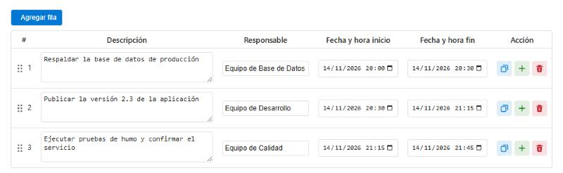

# Tabla de datos para Azure DevOps

Extensión de Azure DevOps que agrega una tabla editable a los elementos de trabajo. Las columnas, los tipos de dato y las validaciones se definen con un JSON. Se usa para planes de cambio, seguimiento de tareas y planificación.



## Documentación

| Documento | Contenido |
|---|---|
| [Guía de usuario, instalación y configuración](overview.md) | Es la misma página que se publica como detalle de la extensión |
| [Historial de cambios](CHANGELOG.md) | Cambios por versión y qué revisar al actualizar |

## Inicio rápido

1. Instala la extensión en tu organización. Es privada, así que primero debe compartirse con ella.
2. En tu proceso heredado, crea un campo de tipo **Text (multiple lines)**.
3. En **Layout → Add custom control**, selecciona **Tabla de datos**.
4. En **Options**, elige el campo y pega tu configuración:

```json
{
  "columns": [
    { "id": "tarea", "name": "Tarea", "dataType": "string", "required": true },
    { "id": "inicio", "name": "Inicio", "dataType": "date", "required": true },
    { "id": "fin", "name": "Fin", "dataType": "date", "required": true }
  ],
  "rules": [
    { "type": "dateOrder", "startColumnId": "inicio", "endColumnId": "fin", "message": "El inicio debe ser anterior al fin" }
  ]
}
```

Todas las opciones están en la [guía](overview.md).

## Desarrollo

### Requisitos

- Node.js 18 o superior
- npm 9 o superior

### Comandos

```bash
# Instalar dependencias
npm install

# Compilar y recompilar al guardar
npm run dev

# Compilar para producción
npm run build

# Compilar y crear el .vsix
npm run package
```

### Estructura

```text
custom-data-table/
├── src/
│   ├── index.ts              # Lógica de la tabla
│   ├── index.html            # Plantilla HTML
│   └── styles.css            # Estilos
├── images/
│   ├── extension-icon.png    # Ícono publicado (128 × 128)
│   ├── extension-icon.svg    # Fuente editable del ícono
│   └── tabla-*.png           # Capturas de la guía
├── overview.md               # Página de detalle de la extensión
├── CHANGELOG.md              # Historial de cambios
├── vss-extension.json        # Manifiesto de la extensión
└── webpack.config.js         # Configuración de compilación
```

La tabla no usa librerías de interfaz: solo los SDK de Azure DevOps.

## Publicar una versión

1. Actualiza [CHANGELOG.md](CHANGELOG.md) y la sección de novedades de [overview.md](overview.md).
2. Ejecuta `npm run package`. El comando sube el último número de la versión en `vss-extension.json` y genera el `.vsix`.
3. Confirma en git el cambio de versión.
4. Prueba el `.vsix` en una organización de pruebas.
5. Súbelo en el [portal del publicador](https://marketplace.visualstudio.com/manage) con **Update**. Las organizaciones que ya la tienen instalada reciben la versión nueva sin reinstalar.
6. Comprueba la página de detalle y un elemento de trabajo real.

Para volver atrás, sube otra vez el código anterior con un número de versión mayor: el Marketplace no acepta un número igual o menor al publicado.

**Si agregas imágenes a la guía:** inclúyelas también en `files` de `vss-extension.json`. Si no, no se verán en la página de detalle.

**Si cambias el ícono:** edita `images/extension-icon.svg` y exporta un PNG de 128 × 128 con el mismo nombre que el actual.

## Licencia

ISC

---

**Reportar un problema:** https://github.com/cvalverdem/custom-data-table/issues
