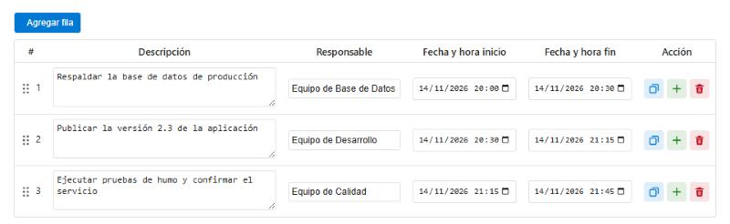
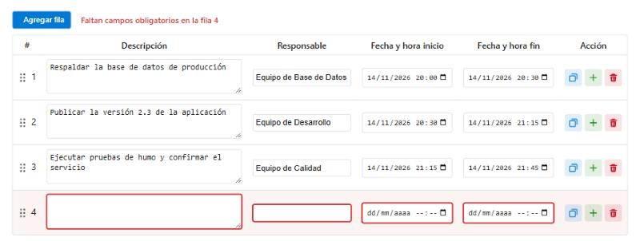
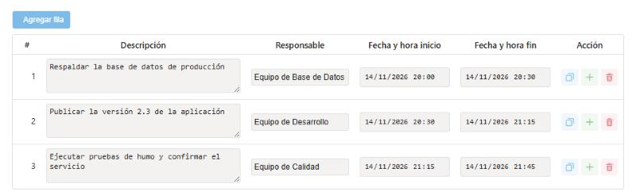

# Tabla de datos para Azure DevOps

Agrega una tabla editable a tus elementos de trabajo. Tú defines las columnas, sus tipos de dato y sus validaciones con un JSON, sin programar. Es ideal para planes de cambio, seguimiento de tareas y planificación.



- **Fácil de llenar:** escribe directo en cada celda, con validación en el momento.
- **Fácil de ordenar:** arrastra filas, duplícalas o inserta una nueva donde la necesites.
- **Controlada:** bloquea la tabla en los estados que indiques e impide guardar datos incompletos.
- **Configurable:** tú eliges las columnas, las reglas y las acciones disponibles.
- **En español:** todos los textos y mensajes de la tabla están en español.

---

# Guía de uso

Esta sección es para quienes llenan la tabla dentro de un elemento de trabajo.

## Agregar y editar filas

1. Presiona **Agregar fila**.
2. Completa las celdas. Los cambios pasan al elemento de trabajo mientras escribes.
3. Presiona **Save** en el elemento de trabajo.

> **Importante:** la tabla no guarda el elemento de trabajo por ti. Si cierras la página sin presionar **Save**, Azure DevOps descarta los cambios, igual que con cualquier otro campo.

## Escribir fechas

Las columnas de fecha piden fecha y hora.

- **Con el teclado:** haz clic en el día y escribe todo de corrido. Por ejemplo, `301020271000` queda como `30/10/2027 10:00`.
- **Con el calendario:** haz clic en el ícono del campo. El calendario ofrece los minutos de 5 en 5, pero al escribir puedes poner cualquier minuto.
- **Formato:** el orden de día y mes, y el formato de la hora, dependen del idioma de tu navegador. El calendario también lo dibuja el navegador.
- **Tecla Tab:** avanza por las partes de la fecha. Desde los minutos pasa al siguiente campo.

## Acciones de cada fila

| Control | Acción | Qué hace |
|---|---|---|
| Asa ⠿ junto al número | Mover | Arrastra la fila a otra posición. Con el asa enfocada, también puedes usar las flechas ↑ ↓ |
| Ícono azul | Duplicar | Crea una copia exacta de la fila justo debajo |
| Ícono verde | Insertar debajo | Crea una fila nueva justo debajo |
| Ícono rojo | Eliminar | Elimina la fila |

Si alguna no aparece, es porque la configuración de tu tabla no la incluye.

## Corregir errores

Los campos con problemas se marcan en rojo y el motivo aparece junto a **Agregar fila**.



Mientras la tabla tenga errores, Azure DevOps muestra un aviso arriba del formulario, por ejemplo `Tabla de datos: Faltan campos obligatorios en la fila 4`, y no deja guardar. Completa los datos o elimina la fila para continuar.

Si te cambias de pestaña en el formulario, las filas incompletas se conservan al volver. Solo se pierde una fecha a medio escribir.

Una fecha sin hora cuenta como vacía. Si la columna no es obligatoria, no se marca como error, pero tampoco se guarda.

## Tabla bloqueada

Cuando el elemento de trabajo está en un estado de solo lectura, como *Finalizado*, o no tienes permiso para editarlo, la tabla se muestra en gris y no se puede modificar. Los campos de texto largo se pueden seguir agrandando para leer todo el contenido.



---

# Guía de instalación

Esta sección es para quienes administran la organización o el proceso de Azure DevOps.

## 1. Instalar la extensión

1. Abre la extensión en el [Marketplace](https://marketplace.visualstudio.com/items?itemName=CentroDeCompetencias.custom-data-table-control-v10).
2. Presiona **Get it free**.
3. Elige tu organización y presiona **Install**.

## 2. Crear el campo de datos

La tabla guarda sus datos como JSON en un campo del elemento de trabajo.

1. Ve a **Organization Settings → Process** y abre tu proceso heredado.
2. Abre el tipo de elemento de trabajo, por ejemplo *User Story*.
3. En la pestaña **Layout**, presiona **New field**.
4. Crea un campo de tipo **Text (multiple lines)**.

## 3. Agregar el control

1. En la pestaña **Layout**, presiona **Add custom control**.
2. En **Definition**, selecciona **Tabla de datos**.
3. En **Options**, completa las opciones de la siguiente tabla.
4. En **Layout**, elige dónde se mostrará la tabla y presiona **OK**.

| Opción | Qué poner |
|---|---|
| **Campo de datos (nombre de referencia)** | El campo que creaste en el paso anterior |
| **Campo de datos (ingreso manual)** | Solo si el selector no aparece: el nombre de referencia, por ejemplo `Custom.DataTableJSON` |
| **Configuración de columnas (JSON)** | El JSON de tu tabla. Si lo dejas vacío, se usa la tabla por defecto: Descripción, Responsable, Fecha y hora inicio, Fecha y hora fin |
| **Fuente** | Fuente de la tabla. Es opcional |
| **Tamaño de fuente** | Tamaño de letra de la tabla. Es opcional |

## 4. Comprobar

Abre un elemento de trabajo de ese tipo, agrega una fila y guárdalo. Si la configuración tiene un error, la tabla no se muestra y aparece un aviso con el detalle.

---

# Configuración

## Ejemplo completo

Este JSON crea una tabla para planes de cambio. Cada tarea empieza cuando termina la anterior, la fecha de inicio debe ser menor que la de fin y la tabla se bloquea en *Finalizado*.

```json
{
  "columns": [
    { "id": "descripcion", "name": "Descripción", "dataType": "textArea", "required": true, "width": "55%" },
    { "id": "responsable", "name": "Responsable", "dataType": "string", "required": true, "width": "25%" },
    { "id": "fechaInicio", "name": "Fecha y hora inicio", "dataType": "date", "required": true, "width": "10%", "defaultFromPrevious": "fechaFin" },
    { "id": "fechaFin", "name": "Fecha y hora fin", "dataType": "date", "required": true, "width": "10%" }
  ],
  "rules": [
    {
      "type": "dateOrder",
      "startColumnId": "fechaInicio",
      "endColumnId": "fechaFin",
      "message": "La fecha inicial debe ser menor que la fecha final"
    }
  ],
  "readOnlyStates": ["Finalizado"],
  "rowActions": ["move", "duplicate", "insert", "delete"],
  "blockSaveOnError": true
}
```

Solo `columns` es obligatorio. Las demás opciones se pueden omitir.

## Columnas

| Propiedad | Obligatoria | Descripción |
|---|---|---|
| `id` | Sí | Identificador único de la columna. No debe repetirse |
| `name` | Sí | Título que se muestra en el encabezado |
| `dataType` | Sí | Tipo de dato (ver la siguiente tabla) |
| `required` | No | Con `true`, la celda no puede quedar vacía |
| `width` | No | Ancho de la columna, por ejemplo `"25%"` o `"200px"` |
| `defaultValue` | No | Valor inicial en las filas nuevas |
| `options` | Solo en `dropdown` | Lista de opciones, por ejemplo `["Alta", "Media", "Baja"]` |
| `defaultFromPrevious` | No | Toma el valor inicial de la fila anterior (ver más abajo) |

| `dataType` | Se muestra como |
|---|---|
| `string` | Texto de una línea |
| `textArea` | Texto de varias líneas, con tamaño ajustable |
| `number` | Número entero o decimal |
| `boolean` | Casilla de verificación |
| `date` | Fecha y hora |
| `dropdown` | Lista de opciones |

> **Antes de cambiar el `id` de una columna:** los datos se guardan por `id`. Si lo cambias, los datos anteriores de esa columna dejan de mostrarse y dejan de guardarse la próxima vez que alguien edite la tabla. Seguirán disponibles en el historial del elemento de trabajo.

### Valores desde la fila anterior

Con `defaultFromPrevious`, una fila nueva toma un valor de la fila anterior:

```json
{ "id": "fechaInicio", "name": "Fecha y hora inicio", "dataType": "date", "defaultFromPrevious": "fechaFin" }
```

- Usa el `id` de la columna que quieres copiar, o `true` para copiar la misma columna.
- Si la fila anterior está vacía en esa columna, se usa `defaultValue`.
- Solo aplica al crear filas: no modifica las existentes ni se recalcula si luego cambias la fila anterior.

## Regla de fechas

`dateOrder` valida que una fecha sea menor que otra de la misma fila.

| Propiedad | Descripción |
|---|---|
| `type` | Siempre `"dateOrder"` |
| `startColumnId` | Columna con la fecha menor. También acepta `start` |
| `endColumnId` | Columna con la fecha mayor. También acepta `end` |
| `message` | Mensaje que se muestra si no se cumple |

## Acciones por fila

`rowActions` define qué controles se muestran. Por defecto aparecen todos.

| Valor | Control |
|---|---|
| `"move"` | Asa para arrastrar la fila |
| `"duplicate"` | Duplicar |
| `"insert"` | Insertar debajo |
| `"delete"` | Eliminar |

- El orden en pantalla es siempre el mismo, sin importar el orden de la lista.
- También acepta un texto separado por comas: `"duplicate, delete"`.
- Con `[]` no se muestra ninguna acción ni la columna *Acción*. Se puede seguir usando **Agregar fila**.

## Bloqueo por estado

`readOnlyStates` lista los estados del elemento de trabajo en los que la tabla no se puede editar:

```json
"readOnlyStates": ["Finalizado", "Cerrado"]
```

- El bloqueo se aplica en cuanto cambias el estado en el formulario, incluso antes de guardar, y se quita si vuelves a otro estado.
- No distingue mayúsculas y minúsculas, pero sí acentos: el nombre debe coincidir con el estado del proceso.
- También acepta un texto separado por comas: `"Finalizado, Cerrado"`.
- La tabla también se bloquea sola si Azure DevOps abre el elemento de trabajo en modo de solo lectura.
- Si cambias a uno de estos estados con filas incompletas sin guardar, Azure DevOps no deja guardar. Vuelve al estado anterior para corregirlas o eliminarlas.

> **Este bloqueo es solo de la interfaz.** Para que el campo tampoco se pueda cambiar por edición masiva, Excel o la API, crea además una regla en el proceso: en **Rules → New rule**, usa la condición *When the work item state is* `Finalizado` y la acción *Make read-only* sobre el campo de la tabla.

## Bloqueo del guardado

Por defecto, si la tabla editada tiene errores, Azure DevOps no deja guardar el elemento de trabajo. Para desactivarlo:

```json
"blockSaveOnError": false
```

- Con `false`, los errores solo se marcan en la tabla y el elemento de trabajo se puede guardar.
- **Riesgo con `false`:** las filas incompletas se guardan tal como están.
- Solo se activa al editar la tabla: abrir un elemento con datos incompletos no impide guardar otros campos.
- Debe ser `true` o `false`, sin comillas.

## Nombre de la tabla en los avisos

`tableName` define cómo se nombra la tabla en el aviso de arriba del formulario. Por defecto es *Tabla de datos*. Es útil si el formulario tiene más de una tabla:

```json
"tableName": "Plan de rollback"
```

Con esa opción, el aviso dice `Plan de rollback: Faltan campos obligatorios en la fila 2`.

## Más ejemplos

**Seguimiento de tareas**

```json
{
  "columns": [
    { "id": "tarea", "name": "Tarea", "dataType": "string", "required": true },
    { "id": "horas", "name": "Horas", "dataType": "number", "defaultValue": 0 },
    { "id": "completado", "name": "Completado", "dataType": "boolean", "defaultValue": false }
  ]
}
```

**Lista con prioridades y solo dos acciones**

```json
{
  "columns": [
    { "id": "item", "name": "Elemento", "dataType": "textArea", "required": true },
    { "id": "prioridad", "name": "Prioridad", "dataType": "dropdown", "options": ["Alta", "Media", "Baja"], "defaultValue": "Media" },
    { "id": "fechaLimite", "name": "Fecha límite", "dataType": "date" }
  ],
  "rowActions": ["move", "delete"]
}
```

---

# Problemas frecuentes

En uso normal, la tabla no muestra mensajes de estado. Solo aparece un aviso si hay un problema.

| Mensaje | Qué significa | Qué hacer |
|---|---|---|
| `⚠️ Configuración de columnas inválida: …` | El JSON tiene un error. La tabla no se muestra y no se lee ni se escribe el campo, para no dañar los datos | Corrige lo que indica el mensaje en las opciones del control |
| `⚠️ Campo no encontrado o no editable: …` | El campo configurado no existe en ese tipo de elemento de trabajo | Revisa el campo de datos en las opciones del control |
| `Faltan campos obligatorios en la fila …` | Hay una celda obligatoria vacía en esa fila. Una fecha sin hora cuenta como vacía | Completa la fila o elimínala |
| `La fecha inicial debe ser menor que la fecha final` | No se cumple una regla de fechas. El texto puede variar según la configuración | Corrige las fechas de la fila marcada |
| `No se pudo actualizar el campo` | Azure DevOps rechazó el valor | Comprueba que puedes editar el campo y vuelve a intentarlo |
| `Error al actualizar el campo (ver consola).` | Ocurrió un error inesperado al escribir en el campo | Recarga la página. Si continúa, reporta el problema |
| `Error al cargar` o `Error al inicializar` | La tabla no pudo cargar | Recarga la página. Si continúa, reporta el problema |

---

# Novedades de la versión 1.5

- Arrastra filas para cambiar su orden.
- Duplica una fila o inserta una nueva debajo. Las acciones ahora son íconos de colores y se pueden configurar con `rowActions`.
- Bloquea la tabla por estado con `readOnlyStates`.
- Toma valores de la fila anterior con `defaultFromPrevious`.
- Escribe fechas de corrido: del año pasa solo a la hora, y Tab ya no se detiene en el ícono del calendario.
- Nuevo ícono de la extensión.

**Si actualizas desde la versión 1.4:**

- **No tienes que reinstalar ni reconfigurar:** los controles y los datos existentes se conservan.
- **El guardado se bloquea si la tabla editada tiene errores:** para el comportamiento anterior, usa `"blockSaveOnError": false`.
- **Un JSON inválido ahora muestra un aviso:** antes la tabla usaba columnas por defecto. Revisa la configuración de tus controles.
- **El control ahora se llama "Tabla de datos":** antes se llamaba *Custom Data Table (DataTables) v3*.

---

**Repositorio:** https://github.com/cvalverdem/custom-data-table

**Reportar un problema:** https://github.com/cvalverdem/custom-data-table/issues
